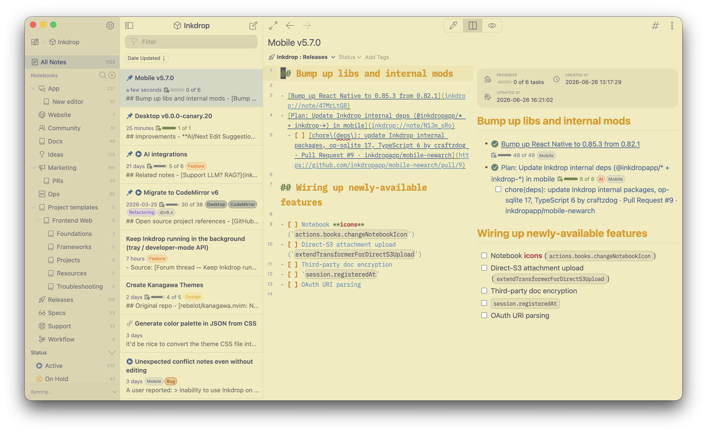

# kanagawa-lotus

The Lotus flavour of [Kanagawa](https://github.com/rebelot/kanagawa.nvim) for Inkdrop —
the light counterpart, drawn from the same painting.
A single theme covering the app UI, the editor syntax highlighting and the Markdown preview.



Other flavours: [Wave](https://my.inkdrop.app/plugins/kanagawa-wave) · [Dragon](https://my.inkdrop.app/plugins/kanagawa-dragon)

## How to install

```sh
ipm install kanagawa-lotus
```

Then enable it in **Preferences → Themes**.

## Development

```sh
pnpm install           # once, from the workspace root
ipm link --dev         # symlink into your Inkdrop data dir for local testing
pnpm exec dev-server   # browse every available variable + live component preview
```

Edit the stylesheets in `styles/` — `palette.css` (palette), `ui.css` (app chrome),
`syntax.css` (editor) and `preview.css` (Markdown preview) — then reload Inkdrop, or use
**Plugins → dev-tools → Start hot reloading themes**.

`palette.json` is generated automatically on publish — `ipm publish` runs
`generate-palette` via the `prepublishOnly` script, so you don't commit it by hand.
