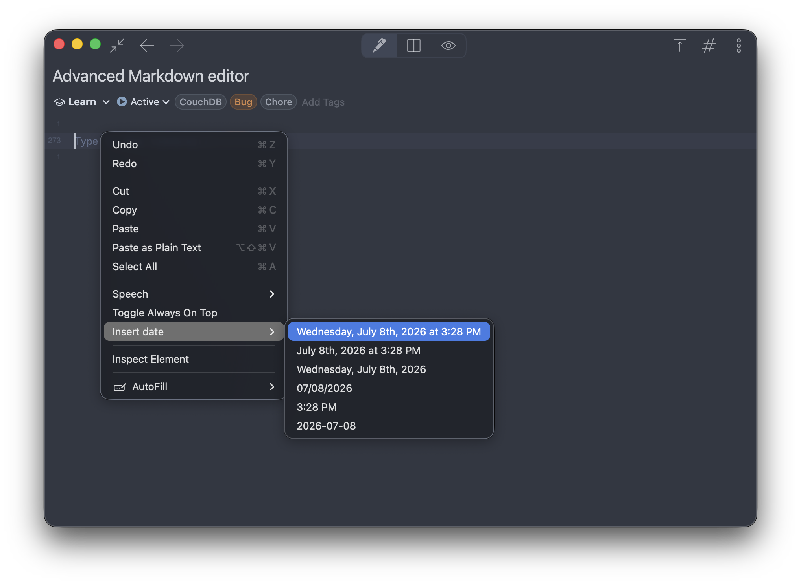

# insert-date



A plugin for [Inkdrop](https://www.inkdrop.app/) that allows you to quickly insert the current date and time into your notes. Uses [date-fns](https://date-fns.org/) for formatting and localization.
It was originally created by [@sambrezo](https://github.com/sambrezo/inkdrop-insert-date).

## Install

```sh
ipm install insert-date
```

## Usage

Right-click in the editor — or in the note title — and pick a format from the `Insert date` submenu. Each entry previews what it will insert, using the current date and your configured locale:

```
Insert date  ▸
    ┌──────────────────────────────────────┐
    │ Wednesday, July 8th, 2026 at 2:58 PM │
    │ July 8th, 2026 at 2:58 PM            │
    │ Wednesday, July 8th, 2026            │
    │ 07/08/2026                           │
    │ 2:58 PM                              │
    │ 2026-07-08                           │
    └──────────────────────────────────────┘
```

Set the **Format** setting (see below) to a pattern of your own and it appears at the top of the menu, rendered the same way:

```
Insert date  ▸
    ┌──────────────────────────────────────┐
    │ Today is Wednesday, July 8th         │  ← your Format setting
    │ ──────────────────────────────────── │
    │ Wednesday, July 8th, 2026 at 2:58 PM │
    │ …                                    │
    └──────────────────────────────────────┘
```

Alternatively you can add a keybinding to your [`keymap.json`](https://docs.inkdrop.app/reference/key-customizations) file like so:

```js
{
  "body": {
    "ctrl-alt-d": "insert-date:run"
  }
}
```

The keybinding inserts your **Format** setting — or `PPPPp` (full date & time) when you haven't set one — into the title if that's where your cursor is, and into the editor otherwise.

## Settings

Please refer to date-fns for all available [format tokens](https://date-fns.org/docs/format).

### Format

**Empty by default** — leave it that way and the menu just offers the predefined formats above.

Set it to add your own entry at the top of the menu; it's also what the keybinding inserts. Here are some common options, shown for `Friday, April 22, 2016 5:14:58 AM`:

- `PPPPp`: Friday, April 22nd, 2016 at 5:14 AM
- `PPPP`: Friday, April 22nd, 2016
- `PPPp`: April 22nd, 2016 at 5:14 AM
- `PPP`: April 22nd, 2016
- `PPp`: Apr 22, 2016, 5:14 AM
- `PP`: Apr 22, 2016
- `Pp`: 04/22/2016, 5:14 AM
- `P`: 04/22/2016
- `p`: 5:14 AM
- `pp`: 5:14:58 AM
- `yyyy-MM-dd`: 2016-04-22
- `MMMM do yyyy, h:mm:ss a`: April 22nd 2016, 5:14:58 AM

### Locale

Applies to the menu entries and to whatever you insert. Shown with the `PPPPp` format:

- `en`: Friday, April 22nd, 2016 at 5:14 AM (default)
- `ja`: 2016年4月22日金曜日 5:14
- `de`: Freitag, 22. April 2016 um 05:14
- `fr`: vendredi 22 avril 2016 à 05:14
- `ko`: 2016년 4월 22일 금요일 05:14

## Migrating from Moment.js formats

Version 0.2.x used [Moment.js](https://momentjs.com/), whose format tokens differ from date-fns'. If you customized the **Format** setting, update it — or clear it, since the menu now covers the common formats:

| Moment | date-fns | Example                             |
| ------ | -------- | ----------------------------------- |
| `LLLL` | `PPPPp`  | Friday, April 22nd, 2016 at 5:14 AM |
| `LLL`  | `PPPp`   | April 22nd, 2016 at 5:14 AM         |
| `llll` | `PPp`    | Apr 22, 2016, 5:14 AM               |
| `LL`   | `PPP`    | April 22nd, 2016                    |
| `ll`   | `PP`     | Apr 22, 2016                        |
| `L`    | `P`      | 04/22/2016                          |
| `LT`   | `p`      | 5:14 AM                             |
| `LTS`  | `pp`     | 5:14:58 AM                          |
| `YYYY` | `yyyy`   | 2016                                |
| `DD`   | `dd`     | 22                                  |
| `D`    | `d`      | 22                                  |
| `A`    | `a`      | AM                                  |

Two of these fail quietly rather than loudly, so it's worth checking your setting:

- `YYYY` and `DD` are **rejected** by date-fns — the plugin shows an error notification instead of inserting anything.
- `LLLL` is still a _valid_ date-fns token, but it means "standalone month" and renders as just `April`.
